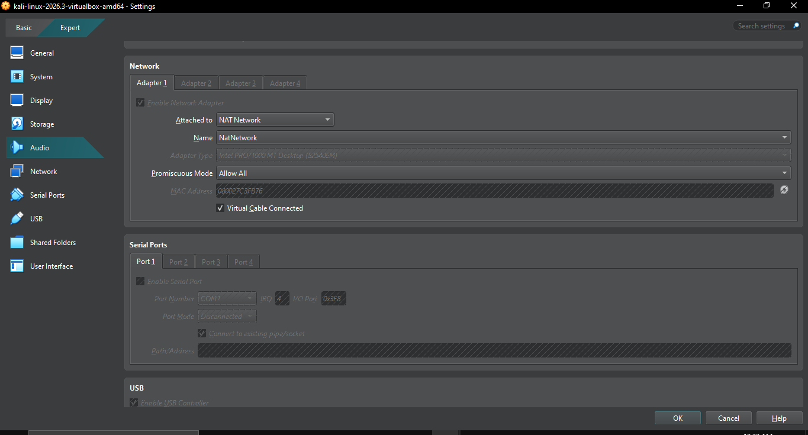
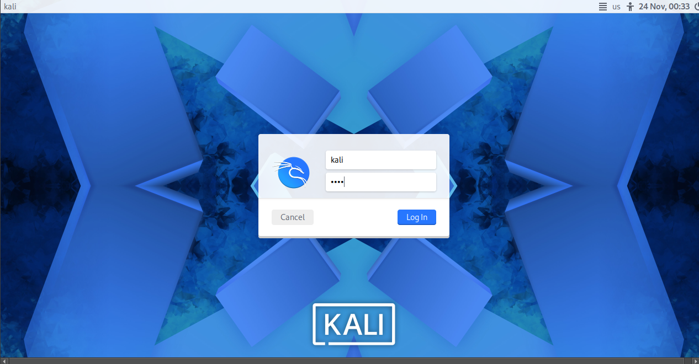
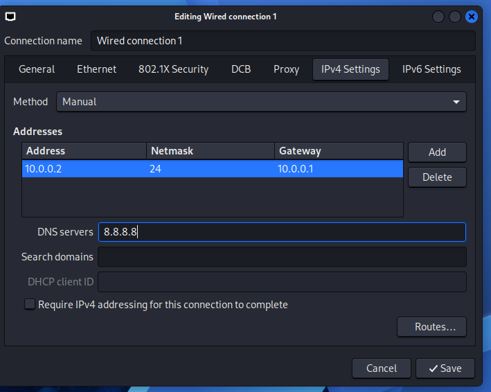
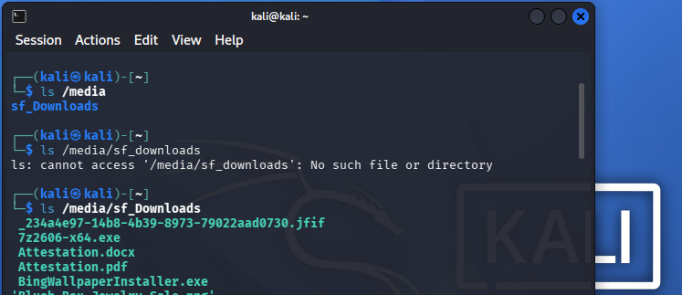
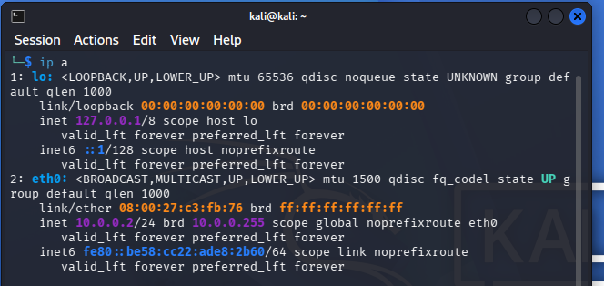
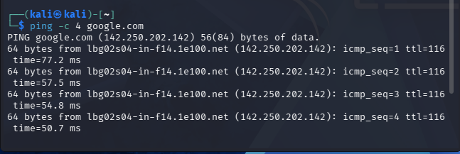
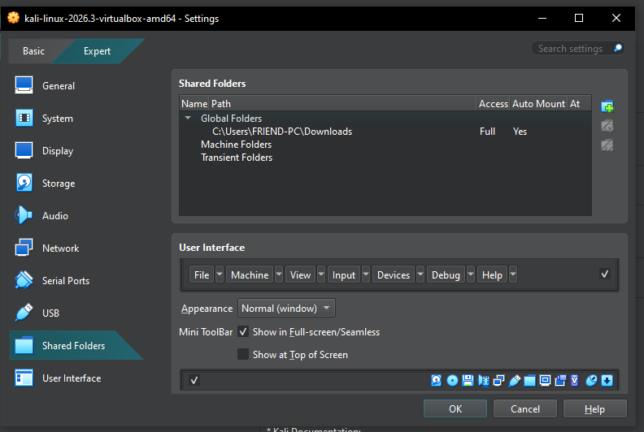
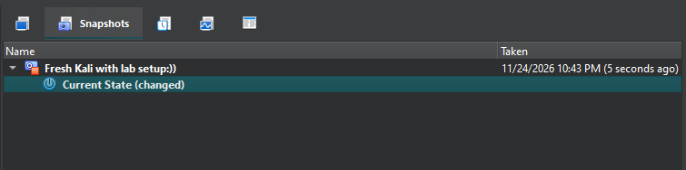
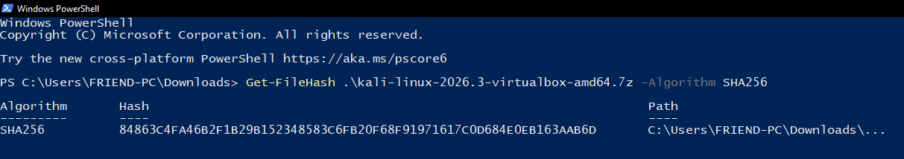

# Week 1 – Practical Lab Environment Setup (VirtualBox + Kali Linux)

**Internship:** Cybersecurity Internship, Networkwalks Academy 
<br>
**Mentor:** Waqas Karim (CCIE)
<br>
**Intern:** Romaisa Khan
<br>
**Project:** WK1-PM1 – Lab Setup

## Objective
Build an isolated cybersecurity practice lab on my own laptop using VirtualBox and Kali Linux, so I can safely practice ethical hacking in later weeks.

## Requirements and Status
| Requirement | Status |
|---|---|
| VirtualBox (latest version) | Done – VirtualBox 7.2.22 |
| Kali Linux (latest) as VM | Done – Kali Linux 2026.3 (VirtualBox image) |
| NATNetwork with 10.0.0.0/24 | Done |
| Clipboard and drag/drop enabled | Done – Bidirectional |
| Shared folder (Downloads) from host | Done – visible in Kali as `sf_Downloads` |
| Full internet access | Done – `ping google.com`, 0% packet loss |
| Kali IP = 10.0.0.2/24 | Done `ip a` shows 10.0.0.2/24 |
| Snapshot of the VM | Done |

## Steps I Followed
1. Downloaded the Kali VirtualBox image from kali.org and verified its **SHA256** checksum with `Get-FileHash` (hash matched).
2. Installed VirtualBox and extracted the image with WinRAR/7-Zip.
3. Extracted the VM to my D: drive because C: was full.
4. Created a NAT Network named `NatNetwork` with prefix `10.0.0.0/24` and DHCP enabled.
5. Imported the Kali VM and attached Adapter 1 to **NAT Network → NatNetwork** (Promiscuous Mode: Allow All).
6. Set **Shared Clipboard** and **Drag'n'Drop** to Bidirectional.
7. Shared the Windows Downloads folder and added my user to the `vboxsf` group.
8. Configured the static IP `10.0.0.2/24`, gateway `10.0.0.1`, DNS `8.8.8.8`.
9. Tested connectivity with `ip a` and `ping -c 4 google.com`.
10. Took a snapshot of the clean VM.

## Screenshots

## Screenshots

### Kali Linux running in VirtualBox


### VM network settings (Adapter 1 = NAT Network)


### Kali login screen


### Network connection settings in Kali


### Terminal - shared folder (sf_Downloads)


### Terminal - static IP 10.0.0.2/24


### Terminal - internet connectivity test


### Shared folder settings (Downloads)


### Snapshot of the VM


### SHA256 checksum verification of the downloaded image


## Problems I Faced and How I Solved Them
- **Download blocked (`ERR_CONNECTION_RESET`):** the connection to the Kali download kept being reset. I verified the final file with its SHA256 checksum to make sure it was complete and genuine.
- **C: drive full (0 bytes free):** extraction failed with a write error. I extracted the VM to the D: drive and kept VirtualBox files there.
- **"Same UUID" error when importing:** an older Kali entry was already registered. I removed it with *Remove Only* and added the VM again from D:.
- **Static IP stuck connecting:** Kali's duplicate-address check stalled the connection. Fixed with:
  ```
  sudo nmcli connection modify "Wired connection 1" ipv4.dad-timeout 0
  sudo nmcli connection down "Wired connection 1"
  sudo nmcli connection up "Wired connection 1"
  ```
- **Kali had no network access (Destination Host Unreachable):** Kali had the static IP 10.0.0.2/24 and gateway 10.0.0.1, but `ping 10.0.0.1` failed with "Destination Host Unreachable".
  - **Diagnosis:** `ip route` showed the correct IP, subnet and gateway, so the settings inside Kali were fine. Then I checked VirtualBox and found that Adapter 1 was attached to plain **NAT** instead of **NAT Network**. Plain NAT uses its own 10.0.2.x network, so nothing was answering at 10.0.0.1.
  - **Test:** I switched Kali to DHCP and it got 10.0.2.15 with gateway 10.0.2.2. Internet worked, which confirmed the VM was on the default NAT network and not on my lab network.
  - **Fix:**
    1. Created the NAT Network `NatNetwork` (10.0.0.0/24, DHCP enabled) in VirtualBox.
    2. Shut down Kali and set Adapter 1 to **NAT Network** with the name **NatNetwork**.
    3. Booted Kali. DHCP gave it 10.0.0.3/24 and internet worked.
    4. Set the static IP with `nmcli`:
       ```
       sudo nmcli con mod "Wired connection 1" ipv4.method manual ipv4.addresses 10.0.0.2/24 ipv4.gateway 10.0.0.1 ipv4.dns 10.0.0.1
       sudo nmcli con mod "Wired connection 1" ipv4.dad-timeout 0
       sudo nmcli con down "Wired connection 1"
       sudo nmcli con up "Wired connection 1"
       ```
    5. Verified with `ip a` (10.0.0.2/24) and `ping -c 4 google.com` (0% packet loss).
  - **Lesson:** a static IP only works if the VM adapter is attached to the network that uses that subnet. When networking fails, check the VirtualBox adapter type before changing anything inside Linux.
- **Typo in the IP address (`Invalid IPv4 address '10.0.2'`):** I typed `10.0.2/24` instead of `10.0.0.2/24`. nmcli rejected it, so nothing changed and the connection restarted with the old settings. I retyped the command with the full four-number address.
- **Copy/paste not working in Kali:** the Shared Clipboard was not enabled yet. I set Shared Clipboard and Drag'n'Drop to Bidirectional in the VM settings, and used Ctrl+Shift+V to paste in the Kali terminal.
## What I Learned
- Why a NAT Network keeps lab traffic isolated from my real network.
- Why snapshots matter: a broken VM can be rolled back in seconds.
- How to verify downloaded files with SHA256 checksums.
- Troubleshooting Linux networking with `ip a`, `ping`, and `nmcli`.

## Tools Used
VirtualBox, Kali Linux 2026.3, WinRAR/7-Zip, PowerShell, NetworkManager (`nmcli`)
